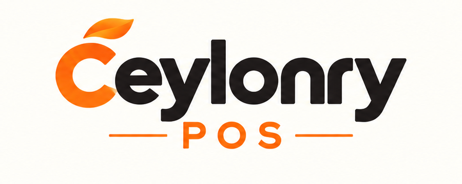
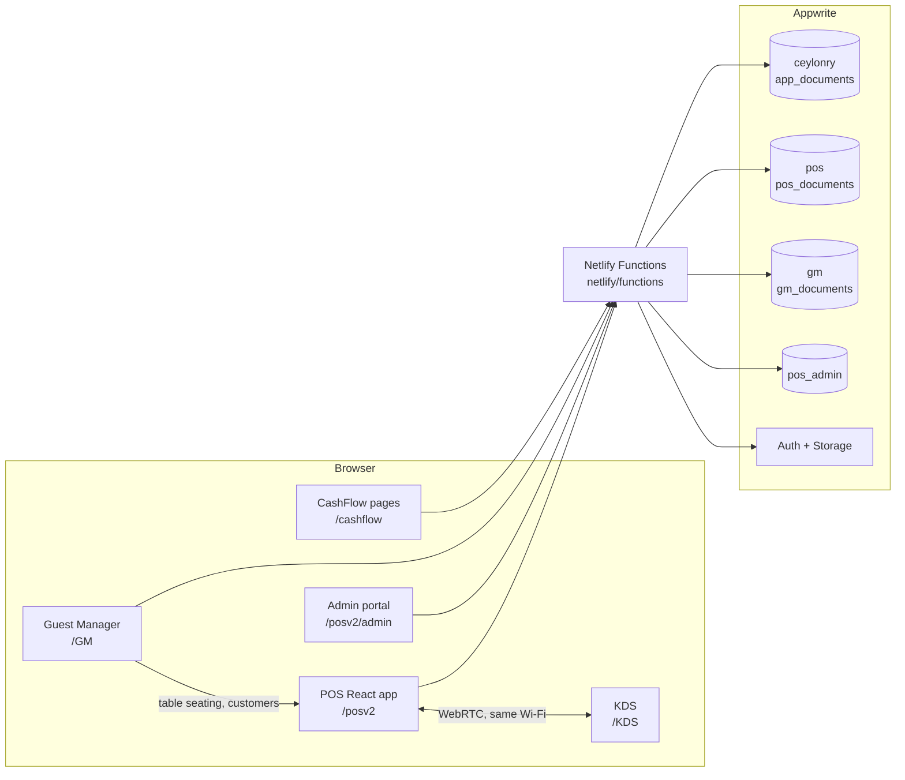
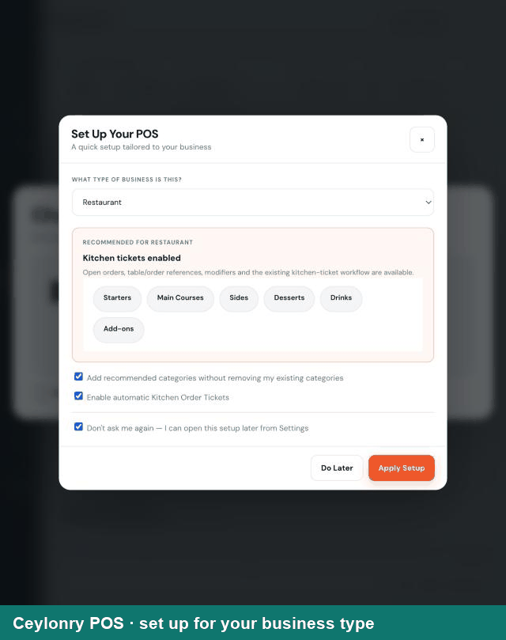
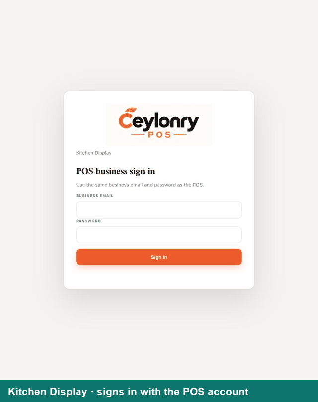
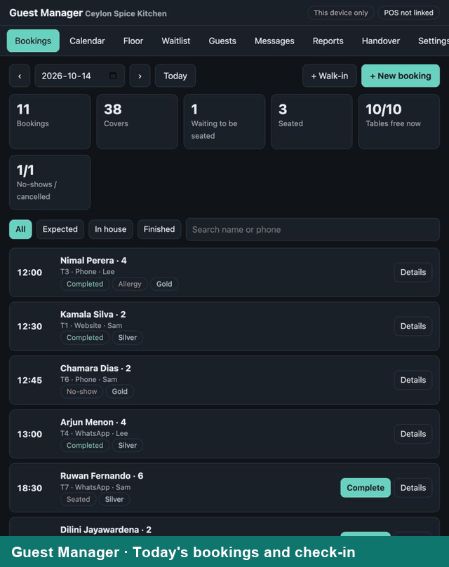
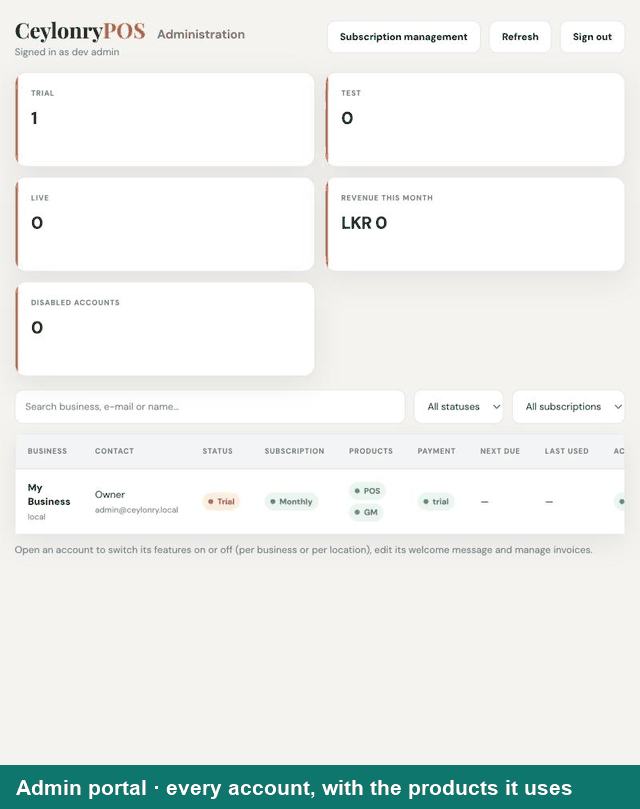
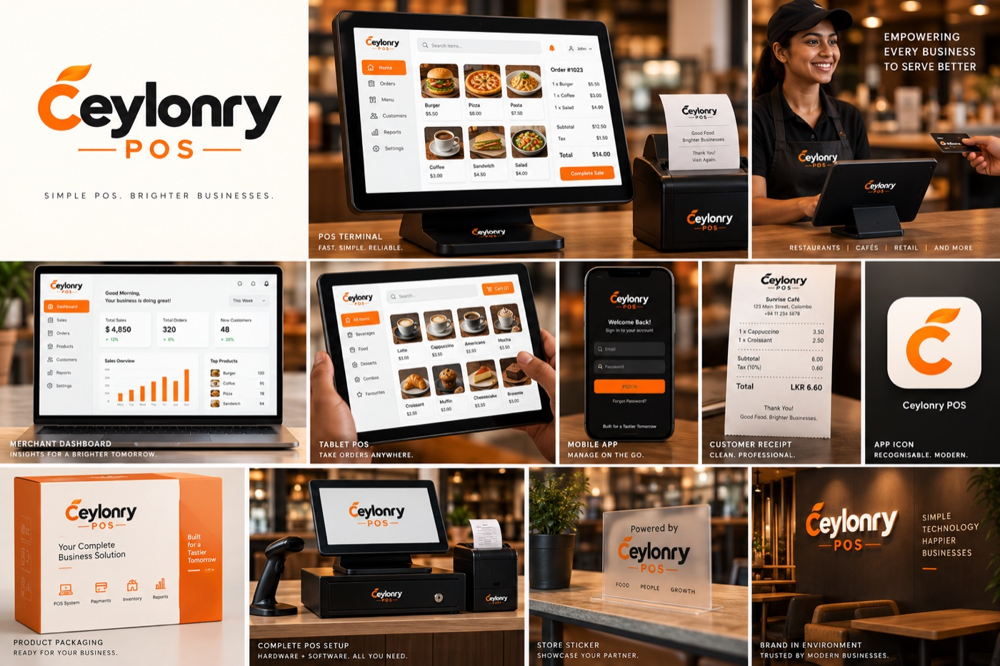

<p align="center">
  
</p>

# Ceylonry — CashFlow, POS, Kitchen Display and Guest Manager

**CeylonryLabs.io** builds business software for small and medium businesses in Sri Lanka: money management (CashFlow), a point-of-sale system (POS) and two restaurant add-ons that work with it (Kitchen Display and Guest Manager). Everything lives in one repository and is published as one Netlify site, backed by one Appwrite project.

Live site: <https://ceylonrylabs.io>

---

## 1. The products

| Product | What it is | Address | Code |
|---|---|---|---|
| **CashFlow** | Invoicing, expenses and cash flow dashboards for freelancers, studios and businesses (Solo, Studio and Business plans), with team access and online payments | `/cashflow/…` (internal use; the CashFlow homepage is `cashflow-home.html`, not linked publicly) | `cashflow-home.html`, `cashflow/`, `assets/` |
| **POS** | Full point of sale: checkout, tables, orders, inventory, customers, staff and cash shifts, reports, receipts and barcode printing. Works offline and syncs to the cloud | [ceylonrylabs.io/posv2/](ceylonrylabs.io/posv2/) | `pos-react/` |
| **POS Admin portal** | For Ceylonry staff only: every account, its plan and subscription, feature switches, invoices, diagnostics, account deletion. Lists which products each account uses | [admin](ceylonrylabs.io/posv2/admin) | `pos-react/src/admin-app/`, `netlify/functions/pos-admin-*.js` |
| **KDS** (Kitchen Display) | A kitchen screen that receives prep tickets from the POS over the local Wi-Fi (WebRTC) and tracks new / preparing / ready | [KDS](ceylonrylabs.io/KDS) | `pos-react/src/KDS/`, `netlify/functions/kds-pair.js` |
| **GM** (Guest Manager) | Table reservations, walk-ins, waitlist, guest profiles and loyalty, WhatsApp/email messages, floor plan, calendar, shift handover and reports. Uses the POS table layout and customers | [GM](ceylonrylabs.io/GM) | `reservation-system/` |

How they fit together:



* **One sign-in.** CashFlow, POS, KDS and GM use the same Appwrite account and browser session. Signing in to one opens the others without asking again.
* **Offline first POS.** The POS keeps its data on the device (WatermelonDB over IndexedDB) and syncs to the cloud document `users/{workspace}/pos/main` with per-row last-writer-wins merging.
* **Feature switches.** Ceylonry staff switch POS features, KDS and GM on or off per business and per location in the admin portal. A subscription plan can lock features off.

---

## 2. Product videos

Short animated walkthroughs, recorded from the running apps with fictional demo data (no real customers). They live in [`assets/GIT/`](assets/GIT/) and are shown here as animated GIFs.

| Product | Walkthrough | File |
|---|---|---|
| **POS** · set up, checkout, pay, order queue, tables, dashboard |  | [`pos-demo.gif`](assets/GIT/pos-demo.gif) |
| **Kitchen Display (KDS)** · sign in, pair, new → preparing → ready |  | [`kitchen-display-demo.gif`](assets/GIT/kitchen-display-demo.gif) |
| **Guest Manager (GM)** · bookings, availability, floor plan, calendar, waitlist, guests, reports, handover |  | [`guest-manager-demo.gif`](assets/GIT/guest-manager-demo.gif) |
| **Admin portal** · accounts with the products they use, per-feature switches |  | [`admin-portal-demo.gif`](assets/GIT/admin-portal-demo.gif) |

Not yet recorded: **CashFlow** (invoicing and cash flow). Full narrated videos can be linked from here when they exist (upload to YouTube *unlisted* or Vimeo rather than committing large video files):

```md
[](https://youtu.be/VIDEO_ID)
```

How the GIFs were made, and how to re-record them, is described in [`assets/GIT/README.md`](assets/GIT/README.md). Customer story (text and photos): `/mrs-gamage-story`.

---|---|---|---|
| POS overview | Getting started with Ceylonry POS | Sign in, add products, ring up a sale, print a receipt, open reports | _Link to be added_ |
| POS for restaurants | Tables, open orders and split bills | Floor plan, seat a table, kitchen tickets, split bill | _Link to be added_ |
| Kitchen Display (KDS) | Pairing and using the kitchen screen | Open `/KDS`, enter the code in POS Settings, new → preparing → ready | _Link to be added_ |
| Guest Manager (GM) | Taking reservations and seating guests | New booking, availability, walk-in, check-in, seat → POS table shows the guest | _Link to be added_ |
| Admin portal | Managing accounts and features | Accounts list with Products column, Features tab, plans, invoices | _Link to be added_ |
| CashFlow | Invoicing and cash flow | Create an invoice, send it, record a payment, team access | _Link to be added_ |

When a video exists, show it with a clickable thumbnail (renders everywhere on GitHub):

```md
[](https://youtu.be/VIDEO_ID)
```

Customer story (text and photos): `/mrs-gamage-story` (`mrs-gamage-story.html`).

---

## 3. Repository structure

Netlify publishes the repository **root** (`publish = "."`), so a file's path is its public address unless `netlify.toml` rewrites it.

```
.
├─ index.html · pos-onboarding.html                 Main landing page (Ceylonry POS) and onboarding page
├─ cashflow-home.html                               Internal CashFlow homepage (noindex, not linked)
├─ privacy.html · terms.html · mrs-gamage-story.html · story-thank-you.html
├─ manifest.webmanifest · sw.js · app/             PWA shell and service worker
├─ cashflow/                                       CashFlow app: sign-in, onboarding, dashboards
│                                                  (solo, starter, growth), team, invites, payments,
│                                                  public invoice, CashFlow admin console
├─ assets/                                         Shared browser scripts, styles, images
│                                                  (appwrite-sdk.js, appwrite-compat.js, platform.js …)
├─ pos-react/                                      The POS (React 18 + Vite + WatermelonDB)
│  ├─ index.html · admin.html · kds.html           Three Vite entry pages (POS, admin portal, KDS)
│  ├─ src/
│  │  ├─ config/        env, roles, presets, FEATURE REGISTRY, plans, subscription limits
│  │  ├─ db/            WatermelonDB schema, tables, store, repositories
│  │  ├─ domain/        Pure business logic (cart, tables, sales, analytics, inventory …)
│  │  ├─ services/      Actions (sales, customers, printing …), cloud sync, auth
│  │  ├─ store/         React providers (data, session, checkout, features, UI)
│  │  ├─ views/ components/ modals/ gates/             Screens and UI
│  │  ├─ admin-app/     Admin portal (accounts, features, subscription, invoices …)
│  │  ├─ KDS/           Kitchen Display app and WebRTC link
│  │  └─ tests/         Vitest suites (≈ 275 tests)
│  ├─ public/           POS manifest, service worker, icons, catalogue template
│  └─ docs/             User guide, admin guide, architecture, development, deployment, testing
├─ reservation-system/                             Guest Manager (static, no build step)
│  ├─ index.html · gm.css
│  └─ js/               app.mjs (UI) · logic.mjs (pure rules) · store.mjs (data) · pos.mjs (POS bridge)
├─ netlify/
│  ├─ functions/        Serverless endpoints (appwrite-docs, pos-admin-*, kds-pair, send-*, payments …)
│  └─ lib/              Shared server code (appwrite.js, security.js, account-purge.js, apps-used.js …)
├─ email-templates/     EmailJS / mail bodies
├─ scripts/             health-check.mjs (build gate), setup-admin-db.mjs, setup-gm-db.mjs,
│                       migrate-pos-to-own-database.js, hash-admin-password.mjs
├─ tests/               Root test suite (node:test)
├─ docs/                Project structure, setup guides, reference notes
├─ netlify.toml         Publish dir, functions dir, redirects, headers
├─ CLAUDE.md · AGENTS.md  Working rules for contributors and AI assistants (see §9)
└─ daily-updates/       Short daily progress notes
```

More detail: [`docs/PROJECT_STRUCTURE.md`](docs/PROJECT_STRUCTURE.md), [`pos-react/docs/`](pos-react/docs/README.md), [`docs/reference/database-and-sync-changes.md`](docs/reference/database-and-sync-changes.md).

### Where data lives (Appwrite project `6a947d6e0012c551dfde`, Singapore)

| Database / collection | Holds | Routed by |
|---|---|---|
| `ceylonry` / `app_documents` | Accounts, profiles, invoices, team invites, payments, everything not listed below | default |
| `pos` / `pos_documents` | POS business data: `users/{uid}/pos…`, split sales months, catalogue backups | `netlify/lib/appwrite.js` (`storeFor`) |
| `gm` / `gm_documents` | Guest Manager: `users/{uid}/gm…` (settings, reservations per month, waitlist, handovers, guests in 16 buckets) | same router (`APPWRITE_GM_ROUTING=off` disables) |
| `pos_admin` | Administrator accounts and audit log (separate from client accounts) | admin functions only |

Browsers never see the Appwrite API key: they call `netlify/functions/appwrite-docs.js`, which checks the signed-in user's permissions and talks to Appwrite with the server-only key.

---

## 4. Run it locally for testing

**Prerequisites:** Node.js 20 or newer (the POS app needs 18+), npm, git. For the full stack also the Netlify CLI (`npx netlify-cli`).

```bash
git clone https://github.com/ceylonleadssystem-io/clscashflow.git
cd clscashflow
git checkout Dev1                 # day-to-day work happens on Dev1 (see §9)
npm install                       # root: Netlify function dependencies
npm --prefix pos-react install    # the POS app
```

### 4.1 POS, offline — no backend, no secrets (easiest)

```bash
cd pos-react
npm run dev                        # http://localhost:5173/
```

`npm run dev` reads the committed `pos-react/.env.development`, which already sets `VITE_AUTH_PROVIDER=local`, so no setup or secrets are needed. Personal overrides go in `pos-react/.env.local` (git-ignored; start from `.env.example`).

* First visit asks you to create a business login (stored hashed on the device). The default owner PIN is `1234`. Data stays in the browser (IndexedDB). Clear site data to start again.
* **Admin portal:** <http://localhost:5173/posv2/admin> (or `/admin.html`). In local mode it shows a development login on the page itself and works on this browser's data, so you can test the Features tab, plans and the accounts list (with the Products column).
* **Kitchen Display:** <http://localhost:5173/kds> (also `/posv2/kds`). Pairing needs the pairing function (see 4.2).

### 4.2 Full stack — real sign-in, cloud sync, GM, pairing

You need the server-side variables from §5 in a **local, uncommitted** `.env` file (ask the project owner; never commit it). Then, from the repository root:

```bash
npx netlify-cli dev                # http://localhost:8888  (serves the site, redirects and functions)
```

In a second terminal, put `VITE_AUTH_PROVIDER=appwrite` in `pos-react/.env.local` (it overrides the local default; `VITE_FUNCTIONS_PROXY` already points to `http://localhost:8888`), then `npm run dev`. Use a **test account**, never a customer's.

With `netlify dev` running you can open `/GM`, `/KDS`, `/posv2/`, `/posv2/admin` and `/cashflow/signin.html` exactly as in production.

### 4.3 Guest Manager only (no backend)

```bash
python3 -m http.server 8080        # from the repository root
# open http://localhost:8080/reservation-system/index.html
# click "Use on this device only (no sync)"
```

Local mode keeps everything in the browser: bookings, walk-ins, waitlist, guests, reports, messages and settings all work; the POS link, loyalty spend and feature check need the full stack (4.2). Add your tables under **Settings → Own tables** to start.

### 4.4 CashFlow pages

They are static pages: serve the root with any static server (`python3 -m http.server 8080`) and open `/cashflow/signin.html`. Sign-in, payments and email need `netlify dev` (4.2).

### 4.5 Tests and checks

```bash
npm run check                      # syntax/links/secret scan of every script and page (also part of the build)
npm test                           # root suite (node:test) — functions, routing, GM logic …
npm --prefix pos-react test        # POS suite (Vitest) — domain, WatermelonDB, sync, admin, KDS
npm --prefix pos-react run build   # production build of the POS, admin portal and KDS
npm run build                      # what Netlify runs: check + POS install + POS build
```

Before opening a pull request, all of these must pass.

---

## 5. Environment variables

Set server variables only in **Netlify → Site configuration → Environment variables** (or a local, git-ignored `.env`). `*.env` files are git-ignored. **Never put secrets in HTML, in `VITE_*` variables or in Git.**

| Variable | Used for |
|---|---|
| `APPWRITE_ENDPOINT`, `APPWRITE_PROJECT_ID`, `APPWRITE_API_KEY` | Appwrite access (the key is server-only) |
| `APPWRITE_DATABASE_ID`, `APPWRITE_COLLECTION_ID` | Main database (`ceylonry` / `app_documents`) |
| `APPWRITE_POS_DATABASE_ID`, `APPWRITE_POS_COLLECTION_ID`, `APPWRITE_POS_ROUTING`, `APPWRITE_POS_FALLBACK` | POS database (`pos` / `pos_documents`); `…ROUTING=off` or `…FALLBACK=off` change routing |
| `APPWRITE_GM_DATABASE_ID`, `APPWRITE_GM_COLLECTION_ID`, `APPWRITE_GM_ROUTING` | Guest Manager database (`gm` / `gm_documents`); `APPWRITE_GM_ROUTING=off` stores GM data in the main database |
| `APPWRITE_ADMIN_DATABASE_ID`, `POS_ADMIN_TOKEN_SECRET` | Admin portal database and its 8-hour session token (≥ 32 random characters) |
| `APPWRITE_IMAGES_BUCKET_ID`, `APPWRITE_COMPRESS` | POS image bucket (`pos-images`); document compression switch |
| `SMTP_HOST`, `SMTP_PORT`, `SMTP_SECURE`, `SMTP_USER`, `SMTP_PASS`, `SMTP_FROM`, `SMTP_REPLY_TO` | Welcome, invite and invoice email (Hostinger: `smtp.hostinger.com`, port `465`) |
| `EMAILJS_*`, `SUPPORT_TO`, `STORY_SUBMISSION_TO` | EmailJS receipts and form notifications |
| `PAYABLE_*`, `STRIPE_SECRET_KEY`, `STRIPE_WEBHOOK_SECRET` | Online payments |
| `PUBLIC_SITE_URL`, `SITE_URL`, `EXTRA_ALLOWED_ORIGINS` | Allowed origins and links in emails |
| `ADMIN_EMAIL` | The CashFlow admin address |

Browser-side POS variables (`pos-react/.env.example`, all `VITE_*`) are public identifiers only: `VITE_AUTH_PROVIDER` (`appwrite` or `local`), `VITE_APPWRITE_ENDPOINT`, `VITE_APPWRITE_PROJECT_ID`, `VITE_DOCS_FUNCTION_URL`, `VITE_FUNCTIONS_PROXY`, EmailJS public keys, support and home links.

---

## 6. One-time setup and deployment

Netlify deploys on every push: `npm run build` (health check, POS install, POS build), functions from `netlify/functions`, publish directory `.`. Pull requests get a deploy preview.

Run these once per environment, with an API key that has the databases scope (the key can be removed afterwards):

```bash
APPWRITE_API_KEY=… node scripts/setup-admin-db.mjs     # admin database, admins, audit log, diagnostics and KDS pairing collections
APPWRITE_API_KEY=… node scripts/setup-gm-db.mjs        # Guest Manager database gm / gm_documents  (BEFORE deploying GM)
node scripts/hash-admin-password.mjs                   # add or update a POS administrator (asks for the details, then saves; see docs/setup/pos-admin-portal.md)
```

Also in the Appwrite console add a **daily backup policy** for each database (`ceylonry`, `pos`, `gm`).

> ⚠️ Run `setup-gm-db.mjs` **before** the site that uses it is deployed. With routing on by default, GM, the `/ready` health check and the account delete expect the `gm` database to exist.

Related guides: [`docs/setup/pos-admin-portal.md`](docs/setup/pos-admin-portal.md), [`docs/setup/netlify-email-setup.md`](docs/setup/netlify-email-setup.md), [`pos-react/docs/deployment.md`](pos-react/docs/deployment.md).

---

## 7. How the main features work

**Accounts and plans.** Each customer has an Appwrite account and a profile. A 15-day trial runs from the profile's `trialEnd`; afterwards the dashboards ask for payment (bank transfer with an uploaded slip, or online payment). Team members are invited from `/cashflow/team.html` and use the owner's data.

**Feature switches (`pos-react/src/config/features.js`).** Every POS feature, plus `view.guestManager` (GM) and `checkout.kds` (KDS), is a switch with a default, dependencies and a group. Admins set them per business or per location; business-category presets (Food & Beverage, Hospitality, Retail …) apply sensible sets; a subscription plan (`config/plans.js`, `config/subscription.js`) can force features off. GM is **off by default**, on in the Food & Beverage and Hospitality presets, and excluded from the Starter plan.

**POS ⇄ GM.**
* GM reads the POS table layout, customers, open checks and sales, and writes guests back as POS customers (tagged `GM:`).
* Seating a guest in GM writes `settings.gmSeating`; the POS Tables screen then shows the guest's first name under the table number, and tapping the table starts the check with that customer already selected (the POS adds the customer to its list if it is missing).
* **Floors.** A POS location can have several floors, each with its own table layout (POS Tables screen: floor tabs, `+ Floor`, Rename, Delete floor). The main floor keeps the original layout setting (`tableLayout_<location>`); other floors use `tableLayout_<location>__<floor id>` and the list is `tableFloors_<location>`. Table numbers are unique across the floors of a location (a check's reference is `Table <number>`). GM shows the same floors and its **Edit tables** editor (Floor tab and Settings) saves back to the POS layout, or to GM's own tables when the layout is not taken from the POS.
* Bills are matched to a booking by table and time, so GM reports show payments, discounts, refunds and revenue by booking source.

**KDS.** `/KDS` shows a six-digit pairing code. Enter it in POS Settings → Printing → Kitchen Display. Tickets travel browser-to-browser over the local network; only the handshake goes through `kds-pair`. Both devices must be on the same Wi-Fi.

**Admin portal.** Sign-in only for `@ceylonrylabs.io` administrators stored in `pos_admin`. The accounts list shows status, subscription, **Products used (POS, GM, KDS)**, payment, next due, last used and access. Per account: Access, Subscription, Features, Welcome message, Invoices, Menu, Diagnostics (browser-to-browser logs, nothing stored on servers) and Delete account (backup, two confirmations, full purge).

**Payments, invites, email.** See the sections in `docs/setup/` and the EmailJS settings below.

---

## 8. Email, payments and invites (reference)

* **SMTP** (welcome email, team invites, invoice fallback): variables in §5.
* **EmailJS** (dashboards and POS receipts): in Settings use your Public Key, Service ID and Template ID. In EmailJS set Subject `{{subject}}`, To `{{to_email}}`, From name `{{from_name}}`, Reply-to `{{reply_to}}`; body `{{{message_html}}}`, or paste `email-templates/emailjs-custom-invoice-template.html` for the no-logo invoice style.
* **Bank-transfer payments:** customers upload a slip; it is emailed to accounts and recorded in the subscription ledger. Payment during the trial starts the paid month when the trial ends. Expired trials create a request under `paymentRequests` that an admin can invoice, mark paid or close.
* **Team invites:** written under `users/{ownerUid}/team/{inviteId}`; `send-invite` emails the link to `/cashflow/accept-invite.html`. If invite creation shows *Not allowed*, check the user is signed in and the invite path above.

---

## 9. Special instructions (read before changing anything)

1. **Do not break existing functionality.** This is a live production system. Make the smallest change that solves the problem, leave unrelated code alone, and report (do not silently fix) unrelated bugs. The full rules are in [`CLAUDE.md`](CLAUDE.md); design-only changes to the POS are governed by [`AGENTS.md`](AGENTS.md) (restyle, never remove or recreate working features).
2. **Branches.** Work on **`Dev1`**; do not create other branches. Open a pull request into `main`, wait for the Netlify deploy preview and checks to pass, then merge. Commit messages describe what changed and why.
3. **Secrets.** Never commit API keys, SMTP passwords, tokens or `.env` files. Browser code only ever holds public identifiers. The health check scans for leaked keys.
4. **Netlify paths are case-sensitive.** `/GM` and `/gm` are separate rules in `netlify.toml`; the canonical addresses are `/GM` and `/KDS` and everything else redirects to them. Admin, GM and KDS are served without caching or framing and marked noindex.
5. **Browser modules for Guest Manager are `.mjs`** (the build's syntax check treats `.js` files as classic scripts). Keep GM free of a build step.
6. **Database changes need a plan.** New collections go into a `scripts/setup-*.mjs` script, are documented in `docs/reference/database-and-sync-changes.md`, and are created **before** the code that uses them is deployed.
7. **Sync merges by timestamp.** Settings merge per key (newest `syncMeta.settings` timestamp wins) and rows merge by id and `updatedAt`. When something “doesn't save”, look for a later write from another device; the server logs *device push changed an admin-controlled setting* with both timestamps.
8. **Keep the graph current.** After code changes run `graphify update .` (knowledge graph in `graphify-out/`). Use `graphify query "<question>"` to explore the codebase before grepping.
9. **UI standards.** Work from 320 px phones to wide desktops, no horizontal scroll, touch-sized controls, keyboard and screen-reader friendly, visible focus, light and dark themes where the app has them.
10. **Test honestly.** Run the checks in §4.5, and say what was and was not tested (for example, cloud sync cannot be exercised without a real account).

---

## 10. Troubleshooting

| Symptom | Likely cause and fix |
|---|---|
| Netlify deploy preview fails in ~30 s | Build step failing early. Run `npm run build` locally. A removed root dependency (`node-fetch-native-with-agent`) once broke deploys; keep it in `package.json` and `pnpm-lock.yaml` |
| `/gm` or `/kds` shows 404 | Redirects are case-sensitive; check the rules at the top of the redirects in `netlify.toml` |
| GM says *Could not check this account's features* | The POS read failed; the page shows the reason. Check sign-in, then the `appwrite-docs` request in the browser Network tab |
| GM says *not switched on* | The page states why: switch never saved, switched off, location override, or plan. Fix it in the admin portal Features / Subscription tabs |
| GM cannot save, `/ready` reports an error, account delete fails | The `gm` database does not exist yet: run `scripts/setup-gm-db.mjs` |
| Admin feature change turns itself off | Another device wrote the same setting later; check the Netlify log line above |
| KDS never connects | Both devices must be on the same Wi-Fi/LAN; strict firewalls and mobile networks block the direct connection (there is no relay by design) |
| Local POS asks to create a login | Expected in `VITE_AUTH_PROVIDER=local`; owner PIN is `1234` |

---

## 11. Documentation index

* POS: [`pos-react/README.md`](pos-react/README.md) and [`pos-react/docs/`](pos-react/docs/README.md) — user guide, admin guide, architecture, development, deployment, testing
* Project layout: [`docs/PROJECT_STRUCTURE.md`](docs/PROJECT_STRUCTURE.md)
* Admin portal setup: [`docs/setup/pos-admin-portal.md`](docs/setup/pos-admin-portal.md)
* Email setup: [`docs/setup/netlify-email-setup.md`](docs/setup/netlify-email-setup.md)
* Database and sync changes: [`docs/reference/database-and-sync-changes.md`](docs/reference/database-and-sync-changes.md)
* Logging: [`docs/reference/logging.md`](docs/reference/logging.md) · Test audit: [`docs/reference/test-audit.md`](docs/reference/test-audit.md)

## 12. Contact

Ceylonry Labs — <hello@ceylonrylabs.io> · <https://ceylonrylabs.io>
