# Shopify online orders: setup guide (for people and agents)

How the Shopify integration of the Ceylonry POS is set up, connected for a merchant, tested and fixed. Written from the real setup of the first store (Noirelle Premium) in November 2026. For why it is built this way see [shopify-feasibility.md](shopify-feasibility.md).

**Rules that apply to anyone (human or agent) doing this**
- Never paste, type or log a secret (client secret, signing secret, access token, `CEYLO_KEY_SECRET`). The person who owns the account copies secrets themselves; an agent only says where they are.
- Passkey, 2-factor and "verify your account" screens belong to the account owner. Stop, say what is on screen, and wait.
- Two Shopify choices **cannot be undone**: the app's distribution method (Custom or Public) and the single-store install link of a Custom app. Ask before doing either.
- A webhook, an app version or an allowlist changes a real store's settings. Do it only when the owner asked for that store.

---

## 1. What exists

| Part | Where | What it does |
| --- | --- | --- |
| Webhook receiver | `netlify/functions/shopify-webhook.js` | Verifies Shopify's signature (the store's signing secret **or** the app's secret), stores the order in a server-only inbox, answers 200. Handles `orders/create` and `orders/cancelled`; duplicates are ignored. |
| Store connection | `netlify/functions/shopify-store.js` | Saves a store (address, location, currency, rate, alert e-mail, optional signing secret), builds the approval link, reports status. Never returns a secret. |
| Install launch (App URL) | `netlify/functions/shopify-launch.js`, route `/shopify/launch` in `netlify.toml` | Where Shopify sends a merchant right after installing. A store already added in the POS goes straight to approval; an unknown one gets instructions. |
| Approval return | `netlify/functions/shopify-oauth.js` | Exchanges Shopify's one-time code for the store's access token (kept encrypted) and subscribes the store's order webhooks. |
| Order actions | `netlify/functions/shopify-order-action.js`, `netlify/lib/shopify-admin.js` | Accept (tag `pos-accepted`), decline (cancel), fulfil with tracking, tracking update, through the Admin GraphQL API. |
| Past orders | `netlify/functions/shopify-orders-import.js` | Pulls a store's past orders into the inbox a page at a time. |
| Inbox for the POS | `netlify/functions/shopify-inbox.js` | The POS pulls new orders (and cancellations) for its location, then acknowledges them. |
| App credentials | `netlify/lib/shopify-oauth.js` | One shared app for every merchant (`SHOPIFY_CLIENT_ID` / `SHOPIFY_CLIENT_SECRET`), optionally a dedicated app per store (`SHOPIFY_CUSTOM_APPS`). |
| POS side | `pos-react/src/services/pos/onlineOrders.js`, `domain/onlineFlow.js`, `domain/shopifyOrder.js`, `views/OnlineOrders.jsx`, `views/settings/OnlineStorePage.jsx`, `modals/OnlineOrderModals.jsx`, `services/printing/packingSlip.js`, `hooks/useOnlineOrdersSync.js` | Settings page, polling, the Online Orders page, accept/decline/fulfil, packing label, CRM customers, SKU matching, past orders as history. |

Data (server-only rows, no owner fields so the browser document API cannot read them): `shopifyShops/{shop}` (store, location, encrypted secrets), `shopifyBusinesses/{ownerUid}` (what the POS may see), `shopifyInbox/{ownerUid}/{o<orderId>}` (orders waiting for a POS). On the POS an order is an open order with channel `Shopify`; where it is in the flow lives in `order.online` (see the header of `domain/onlineFlow.js`).

Feature switch: **Online orders (Shopify)** (`online.shopify`) in the admin Features tab, off for every business until an admin turns it on. It shows the cart button, the Online Orders page, the Online Store settings page and the Online Orders report.

---

## 2. One-time platform setup (Netlify)

Environment variables (Site configuration > Environment variables; scope **Functions**, production; mark secrets as secret). **Deploy again after changing any of them**; functions only read them on a new deploy.

| Variable | Needed for | Where the value comes from |
| --- | --- | --- |
| `CEYLO_KEY_SECRET` | Encrypting every stored secret (also AI keys). At least 32 characters. | You generate it: `openssl rand -hex 32`. Keep it safe: if it changes, stored secrets cannot be read and must be entered again. |
| `SHOPIFY_CLIENT_ID`, `SHOPIFY_CLIENT_SECRET` | The shared app, used by every merchant that has no dedicated app. | Shopify Dev Dashboard > the app > Settings > Credentials (Client ID; "Reveal client secret"). |
| `SHOPIFY_CUSTOM_APPS` (optional) | A store with its own dedicated app. One line of JSON: `{"my-shop.myshopify.com": {"id": "<client id>", "secret": "<client secret>"}}` | Same Credentials page of that store's app. |
| `SHOPIFY_API_VERSION` (optional) | Admin API version for order actions. Default `2026-01`. | Shopify's release calendar. |
| `SMTP_USER`, `SMTP_PASS`, `SMTP_HOST`, `SMTP_PORT`, `SMTP_FROM` | The "closed shop" e-mail when an order arrives while no POS is open. | The same SMTP settings the other e-mails use. |
| `PUBLIC_SITE_URL` (optional) | Base address used in links (default `https://ceylonrylabs.io`). | |

Check the functions are live (a plain visit must **not** be 404):

```bash
curl -s -o /dev/null -w "%{http_code}\n" https://ceylonrylabs.io/.netlify/functions/shopify-webhook   # 405
curl -s -o /dev/null -w "%{http_code}\n" https://ceylonrylabs.io/shopify/launch                        # 400 (refuses what Shopify did not sign)
```

---

## 3. Create the Shopify app (once per app)

Shopify no longer lets new stores create the old "custom app" with a pasted token. An app is created in the **Dev Dashboard** (`https://dev.shopify.com/dashboard/<organization id>/apps`) and the store owner approves it.

**3.1 Create the app.** Apps > Create app. Fill in:
- App name: `Ceylonry POS Online Orders`
- App URL: `https://ceylonrylabs.io/shopify/launch`
- Embed app in Shopify admin: **off**
- Allowed redirection URL: `https://ceylonrylabs.io/.netlify/functions/shopify-oauth`
- Scopes: `read_orders,write_orders,read_merchant_managed_fulfillment_orders,write_merchant_managed_fulfillment_orders`

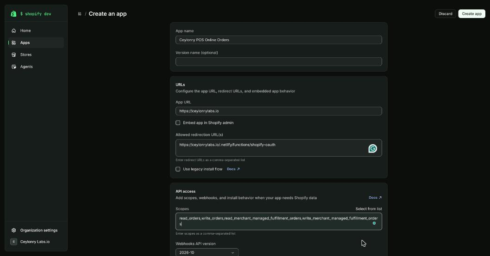

(The screenshot was taken with the first App URL, `https://ceylonrylabs.io`; use the launch address above.)

**3.2 Release the first version.** Shopify asks for it before the app has credentials.

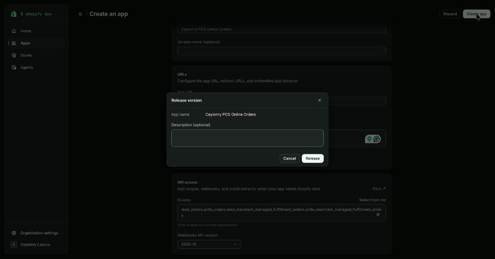
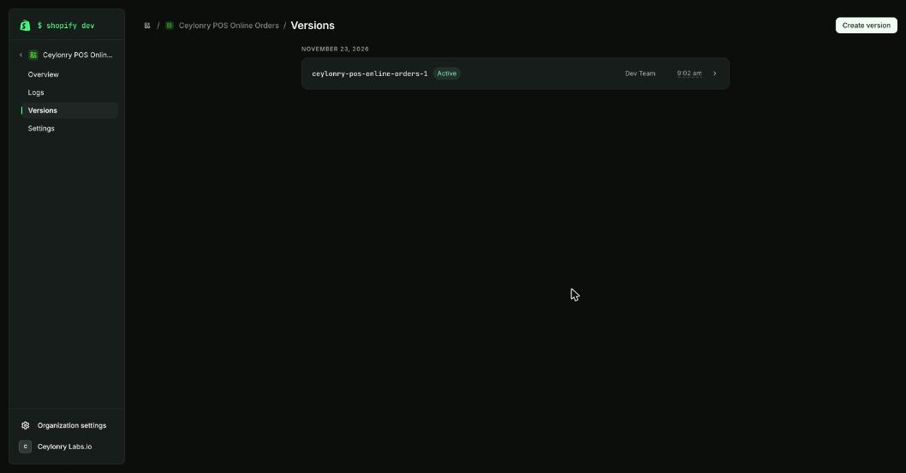

**3.3 Choose the distribution method. Irreversible.**
- **Custom**: installed by an install link made for one store. No Shopify review. A custom app made for a store **can only be installed on that store**.
- **Public**: any merchant can install it (App Store or a direct link). Shopify reviews public apps first, and protected customer data and "Read all orders" must be requested. Needed to open the POS to every merchant.

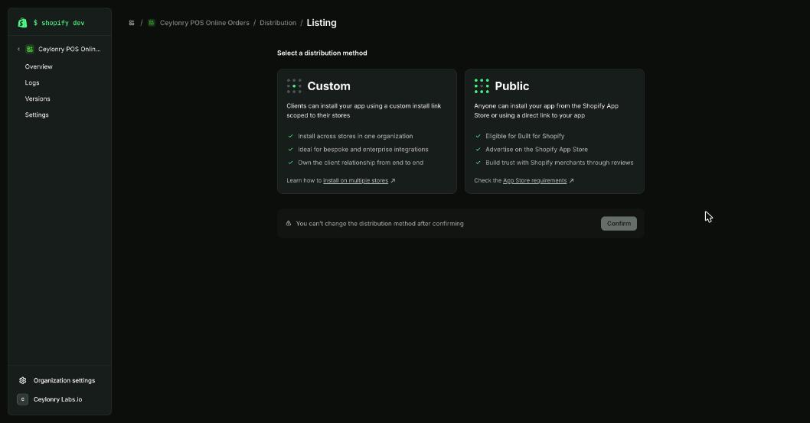

**3.4 Custom only: generate the install link for the store. Irreversible.** Distribution > enter the store address (`<handle>.myshopify.com`), leave the multi-store (Plus organization) option off, Generate link, confirm.

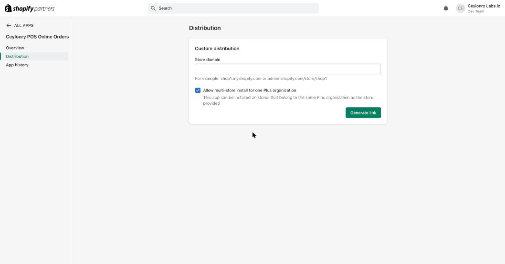
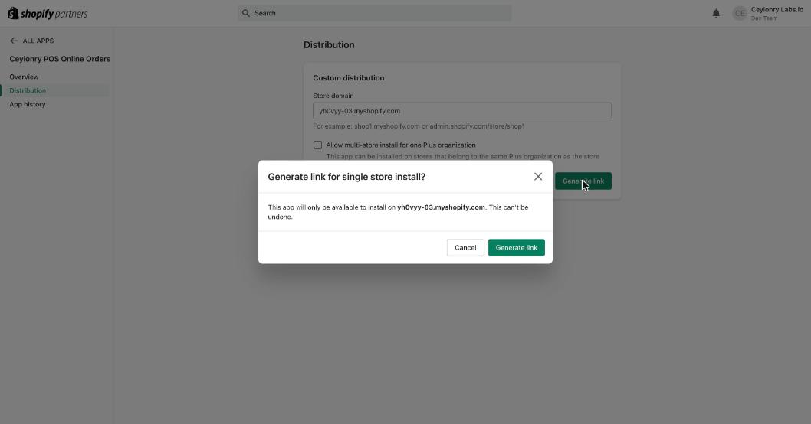
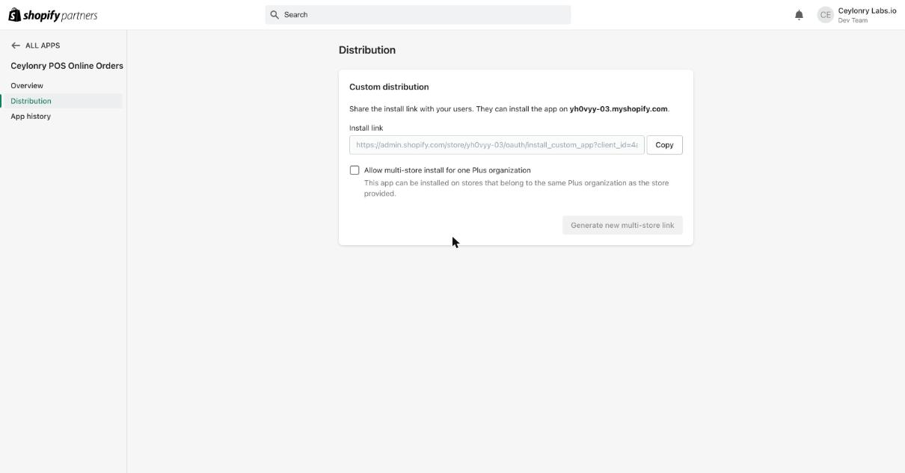

The link opens in a browser signed in to that store's admin as someone allowed to install apps. After approving, Shopify sends the browser to the App URL (our launch page); the app then shows under the store's Settings > Apps.

**3.5 IP allowlist.** Shopify refuses to install the app on a store until the app has an IP allowlist that is **enabled**. App > Settings > IP allowlist > Manage: turn on "Enforce IP allowlist", policy "Allow listed IPs and networks", and list where the POS's calls come from. Netlify has no fixed IP and runs on AWS, so the interim setting is the network **AS16509** (Amazon). A country limit can be added once a test works.

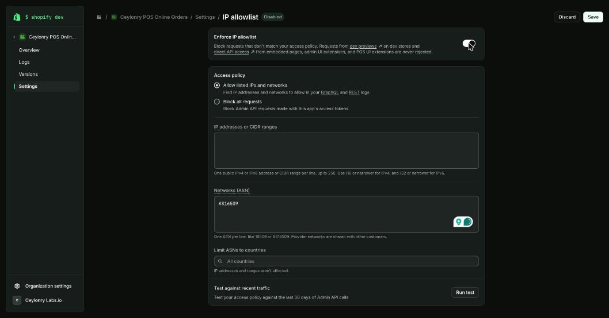
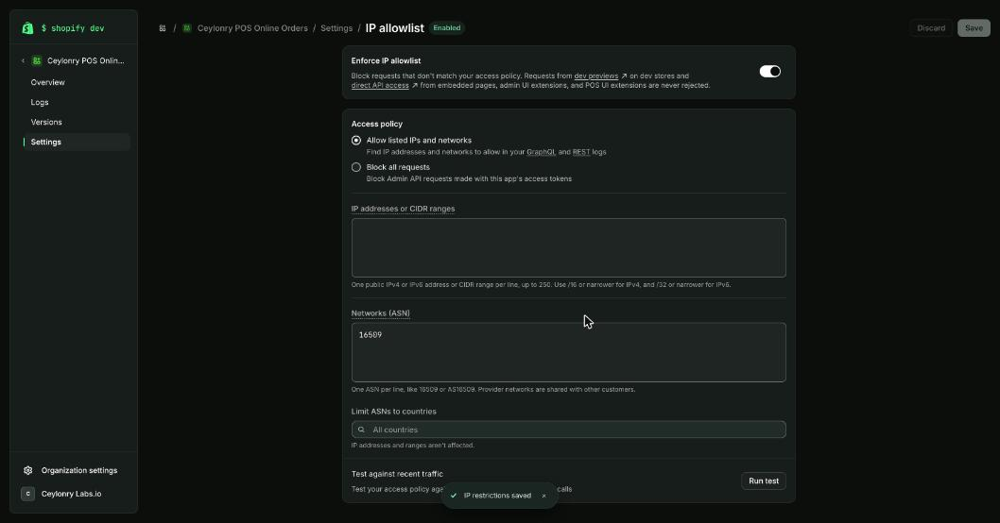

This is weaker than a fixed address (other AWS customers share the network, but they still need the store's encrypted token). The stronger option is to send the Shopify calls through a server with a fixed IP (the planned VPS, see `docs/migration/self-hosting-plan.md`) and allowlist only that address. If a call is blocked, the app's API logs in the Dev Dashboard show the address Shopify saw.

**3.6 App URL after the site is deployed.** If the app was created with another App URL, create a new version with `https://ceylonrylabs.io/shopify/launch` (Versions > Create version, change the App URL, Release).

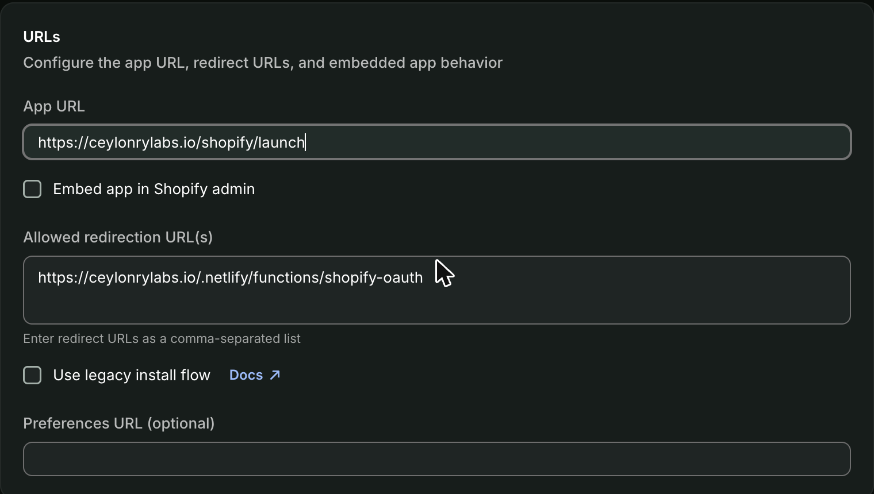
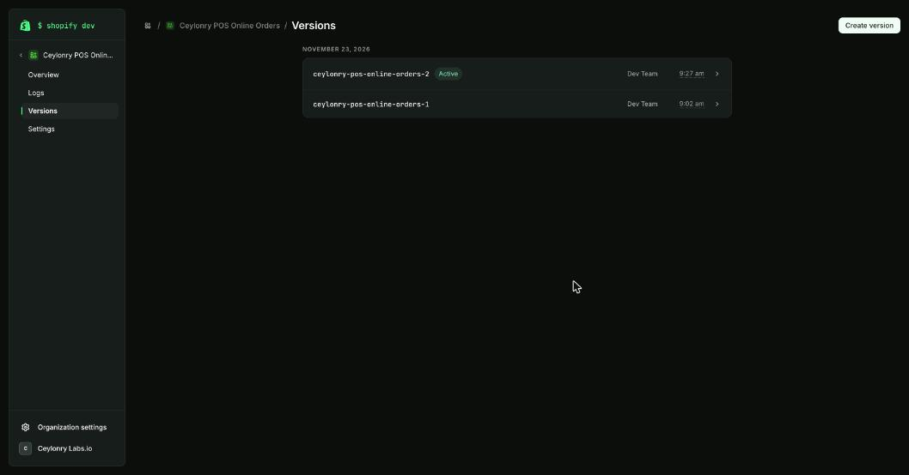

**3.7 Put the credentials in Netlify** (section 2) and deploy.

Current values (not secrets): organization `249339788`, app `450695954433` (custom app installed on Noirelle Premium, `yh0vyy-03.myshopify.com`). The shop's webhook secret and the app's client secret are never written in the repo.

---

## 4. Connect a merchant's store (in the POS)

Prerequisites: the admin switch **Online orders (Shopify)** is on for the business; the business uses the cloud (Appwrite) version; the POS app is installed on the store (section 3.4 or, for a public app, the merchant's install).

1. Settings > System Options > **Online Store**.
2. Enter the store address, the location that prepares its orders, the currency (and the exchange rate to LKR if it is not LKR), an optional alert e-mail.
3. Press **Connect store**. A Shopify tab opens: approve the app. The tab ends on "Shopify access connected".
4. The app has subscribed to order creation and cancellation by itself (signed with the app's secret). The store row shows "Shopify connected" and its last order time.

**Alternative (webhooks made by hand, no Shopify access):** in the store's Settings > Notifications > Webhooks create **Order creation** and **Order cancellation**, format JSON, address `https://ceylonrylabs.io/.netlify/functions/shopify-webhook`, API version the latest stable (not "unstable" or a release candidate). Paste the **signing secret** Shopify shows on that page into the POS under Online Store > Advanced. Orders arrive, but accepting, declining, fulfilling and past orders need the Shopify access above.

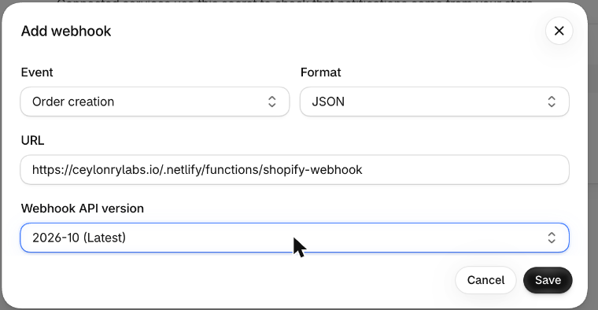

Shopify retries a failing webhook for about 4 hours and then removes it, so connect the store in the POS soon after creating webhooks by hand.

---

## 5. Using it

- **New order** arrives under the cart button **Online orders** (every 30 seconds while the POS is open at the store's location). A badge counts new ones.
- **Accept** (kitchen ticket if the Online Store option is on; asks first when stock is short) or **Decline** (reason, optionally refund, restock and e-mail the customer; cancels the order in Shopify).
- **Fulfill**: records the paid sale on the "Shopify" payment type, takes stock, keeps the tracking and creates the fulfilment in Shopify. **Add tracking**, **Print packing label**, **WhatsApp customer**, **Open in Shopify**, filters by state.
- A state the store did not accept shows "Shopify not updated" or "Shopify access not connected" on the order with **Send to Shopify again**; the POS work is never lost.
- **Past orders**: Online Store > Past orders, choose a date, Import. Open orders arrive as New; fulfilled and cancelled ones are history (no sale, stock, kitchen or POS order number). Shopify shares the last 60 days unless the app is approved for "Read all orders".
- **Reports**: Reports > Sales > Online Orders. **CRM**: customers tagged Shopify (needs Shopify to share customer details: protected customer data).
- Items are matched by SKU: an item whose code is the SKU, then an inventory stock item with that SKU. Anything else is kept as a plain line flagged "not matched", with no stock change.

---

## 6. Test checklist

1. Place a small test order in the store. It appears under Online Orders within about a minute, with the customer and address.
2. Accept it: Shopify shows the tag `pos-accepted`.
3. Add tracking and Fulfill it: the order is fulfilled in Shopify with the tracking and the e-mail arrives (when chosen).
4. Print the packing label.
5. Place and **Decline** a second order: Shopify shows it cancelled (and refunded if chosen). Check this one first on a new API version.
6. Import past orders for a recent date: counts show on screen; a second import adds nothing.
7. Cancel an order in Shopify: the POS voids it and tells staff.

---

## 7. Troubleshooting

| What you see | Cause and fix |
| --- | --- |
| "Saving AI keys is not set up yet. Ask Ceylonry to set CEYLO_KEY_SECRET." | `CEYLO_KEY_SECRET` is missing or not deployed. Set it (section 2) and redeploy. (The wording is shared with the AI keys.) |
| "Shopify access is not set up yet. Ask Ceylonry to set SHOPIFY_CLIENT_ID and SHOPIFY_CLIENT_SECRET." | The app credentials are missing or the deploy is older than the variables. |
| Shopify: "This app must have an IP allowlist configured and enabled before it can be installed" | Section 3.5. |
| Install finished but you landed on the website | Normal for an app that is not embedded: Shopify sends the browser to the App URL. Check Settings > Apps in the store. |
| "Could not connect: This link is not valid or has expired" | The approval was started more than 15 minutes ago, or the app credentials in Netlify do not belong to the app that was installed. Start again from the POS. |
| "Connect the store in the POS first" | The store was not added in the POS before approving. Add it (section 4), then approve again. |
| Order actions say "Shopify access is not connected" | The approval was never finished for that store. Press **Connect Shopify access** / **Approve in Shopify**. |
| "Shopify refused the POS access (401/403)" or a permission message | The token was revoked, a scope is missing, or the IP allowlist blocks the call. Reconnect; check the app's API logs for the blocked address. |
| Decline fails with a Shopify message about a refund option | Shopify deprecated the plain `refund` option of `orderCancel` in favour of `refundMethod`. The code uses the plain option on `SHOPIFY_API_VERSION` (default 2026-01). Pin an older version, or update `cancelOrder` in `netlify/lib/shopify-admin.js` to the new argument. |
| Past orders fail with "Access denied for customer field. Required access: `read_customers` access scope" | The import used to ask for the separate customer record. It now reads the name, phone and e-mail from the order itself, so `read_customers` is not needed. If a deployed version still shows this, it is older than the fix. |
| Past orders: "Could not import past orders." with nothing more | The server reply was not readable, usually a Netlify function **time-out** (about 10 seconds). Each call now fetches 10 orders and writes them in parallel; the POS also says what the server answered ("the server answered 502, it took too long"). If it keeps happening, check the function log in Netlify for `shopify-orders-import`. |
| Past orders stop at about 60 days | Shopify's default. Request "Read all orders" in the app's Settings > Access requests. |
| Orders arrive without a customer name, phone or address | Shopify hides protected customer data until the app is approved for it. Request access in the Dev Dashboard. |
| A webhook is rejected (401) | Signed with a secret we do not know: for hand-made webhooks paste the store's signing secret; for app-made ones the app's secret in Netlify must match the installed app. |
| An order in another currency is not saved | The store has no exchange rate. Connect the store again with the rate. |

---

## 8. Known limits and open items

- **Public app for all merchants** is not created yet (needs Shopify review, customer-data and read-all-orders requests). Until then only stores with their own custom app can connect. A custom app is locked to one store, so each extra store needs its own app and an entry in `SHOPIFY_CUSTOM_APPS`.
- **Fixed IP**: the AWS allowlist is an interim; move to a relay with a fixed address when the VPS exists.
- **Cash on delivery** is not built: every Shopify order is recorded as paid on the "Shopify" payment type.
- **Stock back to Shopify** (inventory levels) is not built; stock only goes down in the POS when an order is fulfilled.
- Shopify calls were verified against a fake Shopify in tests, and the receiving side with the first real store; cancelling an order, fulfilling and reading past orders still need a real test order (section 6).

---

## 9. Tips for agents driving the Shopify admin in a browser

- Use the browser the owner is signed in to. The built-in browser and Claude in Chrome have separate sign-ins; if one is stuck on a passkey screen, ask the owner and try the other.
- Dev Dashboard store rows and some links open in a new tab, which the built-in pane blocks: open the target URL directly instead.
- Native dropdowns do not show their options in screenshots. Focus the select, type the option text (for example `Order creation`, `2026-10`) and press Return, then zoom to confirm the value.
- `scroll_amount` is at most 10 per call; use `scroll_to` with a ref to reach a button.
- The Add webhook dialog is not in the accessibility tree: click by coordinates and confirm with a zoomed screenshot before saving.
- Confirm every irreversible step with the owner first, and report what was changed afterwards.
